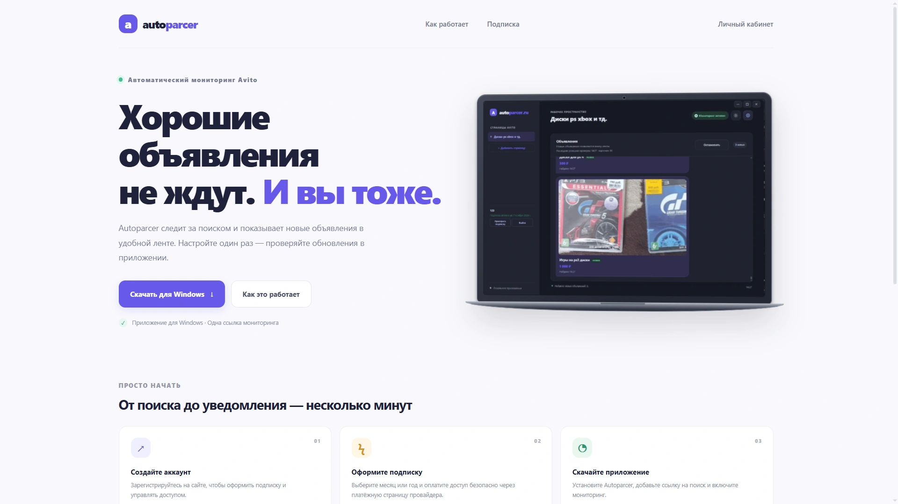

<div align="center">

# AutoParcer

**Новые объявления Avito — в удобной ленте Windows-приложения.**  
**New Avito listings — delivered to a convenient Windows app feed.**

[](https://nodejs.org/)
[](https://www.microsoft.com/windows)
[](#languages)



</div>

---

<a id="languages"></a>

**[Русский](#русский) · [English](#english)**

## Русский

AutoParcer — сервис мониторинга объявлений Avito. Добавьте ссылку на поиск, запустите мониторинг и проверяйте новые объявления в ленте приложения для Windows.

> **Статус проекта:** эта версия была создана примерно за два дня и остаётся очень сырым прототипом. Репозиторий опубликован прежде всего для ознакомления и дальнейшей доработки; это не готовый продукт. Перед реальным использованием внимательно проверьте код, настройте безопасность и инфраструктуру, проведите тестирование и внесите необходимые изменения. Не запускайте проект в production без отдельной проверки.

> **Важно:** мониторинг работает на компьютере пользователя. Для проверки объявлений компьютер и приложение должны быть включены. AutoParcer — независимый проект, не связанный с Avito. Используйте сервис в соответствии с применимыми правилами и условиями площадки.

### Возможности

- регистрация и вход по логину;
- личный кабинет со статусом подписки и сменой пароля;
- месячный и годовой тарифы с разовой оплатой через ЮKassa;
- приём и проверка уведомлений об успешной оплате;
- административная панель для управления аккаунтами и подписками;
- отдельная авторизация Windows-приложения с проверкой подписки;
- раздача установщика пользователям с активной подпиской;
- хранение аккаунтов и платежей в SQLite.

### Структура репозитория

| Путь | Назначение |
| --- | --- |
| `autoparcer-site/server.js` | HTTP-сервер, API, авторизация и работа с SQLite |
| `autoparcer-site/billing.js` | Расчёт стоимости и срока подписки |
| `autoparcer-site/public/` | Сайт, личный кабинет и административная панель |
| `autoparcer-site/test/` | Автоматические тесты |
| `autoparcer-site/app/` | Собранный установщик приложения для Windows |
| `autoparcer-site/.env.example` | Пример конфигурации сервера |

В репозитории есть установщик Windows, но **исходный код Electron-приложения в этой копии проекта не включён**.

### Требования

- Node.js **22.13.0 или новее**;
- npm (поставляется вместе с Node.js).

### Локальный запуск

Откройте терминал в папке `autoparcer-site`:

```powershell
cd autoparcer-site
Copy-Item .env.example .env
npm start
```

Для разработки с автоматическим перезапуском:

```powershell
npm run dev
```

Откройте [http://localhost:4175](http://localhost:4175). Локальная база SQLite создаётся в `autoparcer-site/data/autoparcer.sqlite`.

### Настройка

Основные параметры задаются в `autoparcer-site/.env`:

| Переменная | Назначение |
| --- | --- |
| `PORT` | Порт сервера; по умолчанию `4175` |
| `PUBLIC_ORIGIN` | Публичный origin сайта; локально `http://localhost:4175` |
| `DB_PATH` | Путь к файлу SQLite; по умолчанию `data/autoparcer.sqlite` |
| `SUBSCRIPTION_PRICE_RUB` | Стоимость месячного тарифа в рублях; по умолчанию `990` |
| `ADMIN_USERNAMES` | Зарегистрированные логины администраторов через запятую |
| `ADMIN_PATH` | Секретный URL административной панели |
| `APP_DOWNLOAD_PATH` | Путь к локальному установщику Windows |
| `APP_DOWNLOAD_URL` | Внешний HTTPS-адрес установщика |
| `YOOKASSA_SHOP_ID` | Идентификатор магазина ЮKassa |
| `YOOKASSA_SECRET_KEY` | Секретный ключ магазина ЮKassa |
| `TRUST_PROXY` | Доверять заголовкам прокси; включайте только за настроенным reverse proxy |
| `NODE_ENV` | Окружение сервера; используйте `production` при публикации |

Без настроек ЮKassa локальный запуск сайта доступен, но для приёма платежей нужны учётные данные магазина, публичный HTTPS-адрес и настроенный webhook. Не публикуйте `.env`, секретный ключ ЮKassa или файл базы данных.

Перед запуском в production настройте HTTPS, постоянное хранилище и резервное копирование SQLite. Для ограничения доступа к установщику задайте `APP_DOWNLOAD_PATH`: локальный файл выдаётся маршрутом `/download` только вошедшим пользователям с активной подпиской. Внешний `APP_DOWNLOAD_URL` может быть доступен напрямую всем, у кого есть ссылка.

Более подробные заметки по настройке сайта доступны в [`autoparcer-site/README.md`](./autoparcer-site/README.md).

### Тесты

```powershell
cd autoparcer-site
node --test
```

### Лицензия

В репозитории пока нет файла лицензии. Публикация кода сама по себе не предоставляет разрешения на его использование, изменение или распространение.

---

## English

AutoParcer is an Avito listing monitoring service. Add a search URL, start monitoring, and follow new listings in the Windows app feed.

> **Project status:** this version was built in about two days and remains a very rough prototype. This repository is shared primarily for review and further development; it is not a finished product. Before real-world use, carefully review the code, secure the configuration and infrastructure, test it, and make any necessary changes. Do not deploy it to production without an independent review.

> **Note:** monitoring runs on the user's computer. The computer and app must be running to check for listings. AutoParcer is an independent project and is not affiliated with Avito. Use the service in accordance with applicable rules and platform terms.

### Features

- account registration and login with a username;
- an account page with subscription status and password management;
- monthly and annual plans with one-time payments via YooKassa;
- payment webhook processing and payment verification;
- an admin panel for managing accounts and subscriptions;
- separate Windows app authentication with subscription checks;
- installer downloads for users with an active subscription;
- SQLite storage for accounts and payment records.

### Repository structure

| Path | Purpose |
| --- | --- |
| `autoparcer-site/server.js` | HTTP server, API, authentication, and SQLite access |
| `autoparcer-site/billing.js` | Subscription pricing and expiry calculations |
| `autoparcer-site/public/` | Website, account pages, and admin panel |
| `autoparcer-site/test/` | Automated tests |
| `autoparcer-site/app/` | Packaged Windows app installer |
| `autoparcer-site/.env.example` | Example server configuration |

The repository includes a Windows installer, but **the Electron app's source code is not included in this project snapshot**.

### Requirements

- Node.js **22.13.0 or later**;
- npm (included with Node.js).

### Run locally

Open a terminal in the `autoparcer-site` directory:

```powershell
cd autoparcer-site
Copy-Item .env.example .env
npm start
```

For development with automatic restarts:

```powershell
npm run dev
```

Open [http://localhost:4175](http://localhost:4175). The SQLite database is created at `autoparcer-site/data/autoparcer.sqlite`.

### Configuration

Configure the server with `autoparcer-site/.env`:

| Variable | Purpose |
| --- | --- |
| `PORT` | Server port; defaults to `4175` |
| `PUBLIC_ORIGIN` | Public site origin; use `http://localhost:4175` locally |
| `DB_PATH` | SQLite database path; defaults to `data/autoparcer.sqlite` |
| `SUBSCRIPTION_PRICE_RUB` | Monthly plan price in RUB; defaults to `990` |
| `ADMIN_USERNAMES` | Comma-separated usernames of registered administrators |
| `ADMIN_PATH` | Secret URL path for the admin panel |
| `APP_DOWNLOAD_PATH` | Path to a local Windows installer |
| `APP_DOWNLOAD_URL` | External HTTPS URL for the installer |
| `YOOKASSA_SHOP_ID` | YooKassa shop ID |
| `YOOKASSA_SECRET_KEY` | YooKassa shop secret key |
| `TRUST_PROXY` | Trust proxy headers; enable only behind a correctly configured reverse proxy |
| `NODE_ENV` | Server environment; set to `production` when deploying |

The website can run locally without YooKassa credentials, but accepting payments requires shop credentials, a public HTTPS origin, and a configured webhook. Never publish `.env`, the YooKassa secret key, or the database file.

Before deploying, configure HTTPS, persistent storage, and SQLite backups. To restrict installer access, set `APP_DOWNLOAD_PATH`: the `/download` route serves this local file only to signed-in users with an active subscription. An external `APP_DOWNLOAD_URL` may be directly accessible to anyone with the link.

For additional deployment notes, see [`autoparcer-site/README.md`](./autoparcer-site/README.md) (currently in Russian).

### Tests

```powershell
cd autoparcer-site
node --test
```

### License

There is no license file in this repository yet. Publishing the code does not, by itself, grant permission to use, modify, or distribute it.

---
